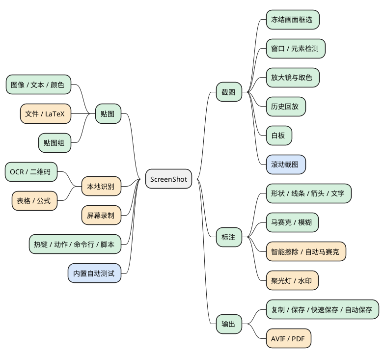
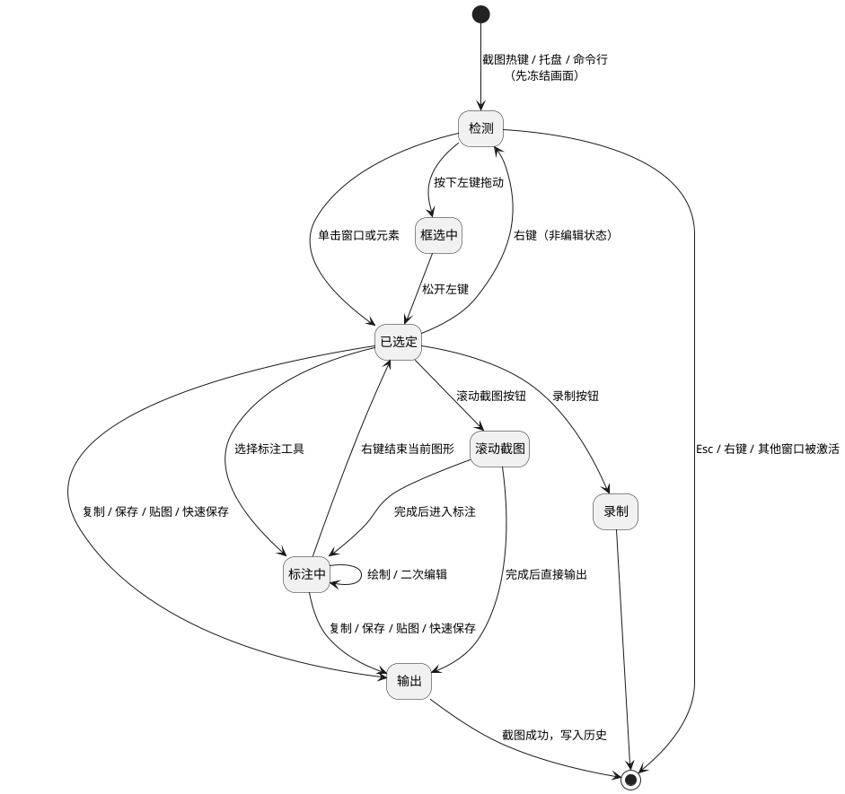
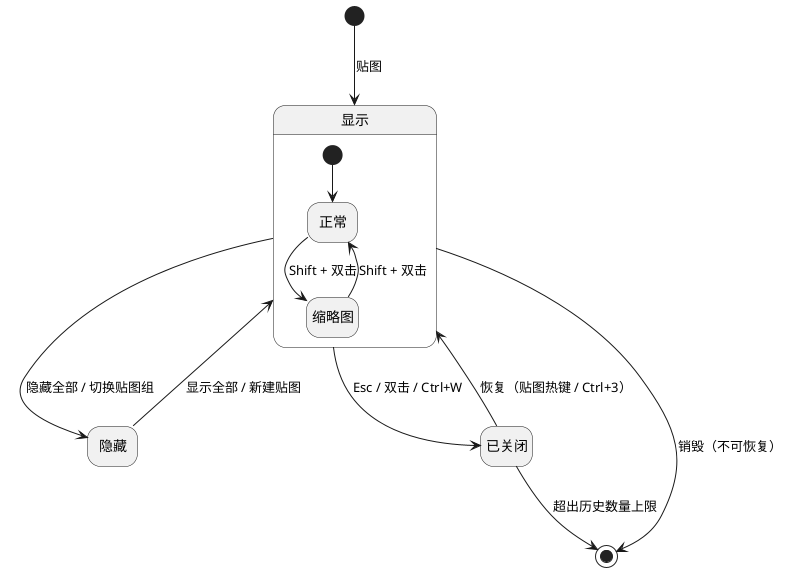
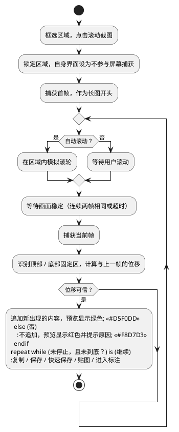

# ScreenShot 需求文档

## 概述

### 背景

本项目用正向开发的方式，在 Windows 和 macOS 上做一款截图 + 贴图工具：逐项复刻 Snipaste 的功能，补上 PixPin 比 Snipaste 多出的功能，并在截图中加入滚动截图。

`ScreenShot` 只是代号（取自仓库目录名），正式产品名待定（见 ）。

### 目标

- 功能覆盖 Snipaste 2.11.3（免费版 + PRO）的全部公开功能，以及 PixPin 3.5 中 Snipaste 没有的功能，联网类功能除外。
- Windows 和 macOS 功能一致，只有系统本身做不到的地方例外（见 ）。
- 体验不低于 Snipaste：按下热键到可以框选的延迟、常驻内存、截图画质都有量化指标（见 ）。
- 滚动截图稳定可用：手动滚动和自动滚动都支持，画面匹配不可靠时宁可不拼也不出错图。
- 每条需求、每个场景都有脚本化的自动测试，无人值守运行（见 ）。

==判断完成的标准：本文所有 P0、P1 需求在 Windows 上实现，并通过  的验收用例和  的全部自动测试；macOS 代码同步完成，构建和测试待有设备后进行。==

### 范围

Table: 范围界定 {.lead}

| 类别 | 内容 |
|---|---|
| 包含 | 截图（含滚动截图）、标注、输出、贴图、贴图组、取色、本地识别（OCR / 条码 / 表格 / 公式）、屏幕录制、热键与动作、命令行与脚本、偏好设置、内置自动测试 |
| 不包含 | 一切联网功能：翻译、在线 OCR、下载网页图片、检查更新、网络代理；付费墙：激活、会员、购买入口、功能限制；账号与云同步；应用商店版本；使用数据统计 |
| 平台 | Windows 10 2004（19041）及以上 x64，包括 Windows 10 LTSC 2021 和 Windows 11；macOS 14.4 及以上，Apple 芯片与 Intel 机型；Windows ARM64 为 P2 |

### 假设

- `A-01` 两个平台的代码同步编写。目前没有 Mac 设备，macOS 部分只编写、不编译、不测试，交付时标为未验证，有设备后再补做构建和测试。
- `A-02` 两款软件中需要付费才能使用的功能全部纳入；本项目不设付费墙。
- `A-03` 程序不包含任何网络功能，也不发起网络请求。识别类功能需要的模型随离线组件包一起提供，不在程序里下载。
- `A-04` Windows 上默认快捷键沿用 Snipaste（截图 F1、贴图 F3）；macOS 的默认快捷键待定（见 ）。全部可改。
- `A-05` 滚动截图是截图的子功能，排在截图、标注、贴图三块基础能力之后实现（见 ）。

### 净室原则

> [!warn] 必须遵守
> 功能依据只能是公开文档和黑盒使用观察。不反编译、不反汇编、不分析两款软件的二进制文件；不复制它们的图标、音效、界面文案、翻译文件和配置文件格式；产品名、图标、文案全部自行设计。

快捷键方案和命令行语法属于功能接口，可以参考，但文案和帮助文本要自己写。

### 术语

冻结画面
: 按下截图热键的瞬间，把所有显示器的画面抓下来，作为全屏背景显示，在它上面框选。框选期间屏幕内容不再变化。

贴图
: 把图像、文本、颜色、文件等内容变成置顶的浮动窗口钉在屏幕上，也叫图像窗口。

截图成功
: 截图以复制、保存、贴图、快速保存之一结束。只有成功的截图才进入历史。

关闭 / 销毁
: 关闭的贴图进入历史，可以恢复；销毁的贴图不进历史，无法恢复。

UI 元素检测
: 借助系统的辅助功能接口（Windows 的 UI Automation、macOS 的 Accessibility），识别鼠标下方的按钮、文本框等控件的边界。

滚动截图
: 在一个可滚动区域里连续捕获画面，按滚动距离把新出现的内容拼成一张长图。

### 编号规则

- 编号格式为“模块前缀-序号”，例如 `CAP-01`。删除的编号不再复用。
- 优先级：:danger[P0] 必须有，缺了产品不可用；:warn[P1] 应该有，达到 Snipaste PRO 水平；:muted[P2] 可以有，PixPin 扩展和锦上添花。
- 来源：:m[Snipaste] 免费版已有，:m[SnipastePro] 是 PRO 功能，:m[PixPin] 是 PixPin 有而 Snipaste 没有，:m[新增] 是两者都没有。
- 平台：默认两个平台都要实现；只适用于一个平台的需求标注 :k[仅 Windows] 或 :k[仅 macOS]。快捷键按 Windows 书写，macOS 上 Ctrl 对应 Cmd。

## 用户与场景

Table: 典型场景 {.lead}

| 编号 | 场景 | 用到的能力 |
|---|---|---|
| `S-01` | 开发者截取报错弹窗，标出关键行，发到聊天软件 | 窗口检测、矩形、箭头、复制 |
| `S-02` | 设计师把参考图钉在屏幕边上，半透明叠在画布上对照 | 贴图、缩放、透明度、鼠标穿透 |
| `S-03` | 产品经理截一整页网页或一整段聊天记录 | 滚动截图 |
| `S-04` | 运营在对外截图里打码头像和手机号，加水印 | 马赛克、自动马赛克、水印 |
| `S-05` | 学生把论文里的公式截下来转成 LaTeX | 公式识别、公式贴图 |
| `S-06` | 讲师录一段操作演示，显示键盘按键，导出 GIF | 屏幕录制 |
| `S-07` | 用脚本或热键一键截取固定区域并存档 | 命令行、动作、自动保存、路径变量 |

## 功能总览

绿色是 Snipaste 已有的能力，橙色是 PixPin 的扩展，蓝色是本项目的重点新增。PixPin 也有长截图，但本项目额外要求自动滚动和更严格的防错拼，见 。

## 截图会话与贴图生命周期

穿透、锁定、置顶、灰度等是“显示”状态下的独立属性，可以叠加，不是互斥状态。

## 功能需求

### 常驻与托盘 {#req-gen}

Table: 常驻与托盘 {.lead}

| 编号 | 需求 | 来源 | 优先级 |
|---|---|---|---|
| `GEN-01` | 常驻后台并显示托盘图标（macOS 为菜单栏图标）；单实例运行，再次启动时把命令转交给已运行的实例 | :m[Snipaste] | :danger[P0] |
| `GEN-02` | 托盘左键截图、中键贴图、右键弹出菜单；各种点击可改成其他动作（macOS 菜单栏只区分左键和右键） | :m[SnipastePro] | :danger[P0] |
| `GEN-03` | 托盘菜单：截图、贴图、显示 / 隐藏全部贴图、贴图组、恢复屏幕外贴图、禁用热键、偏好设置、帮助、退出 | :m[Snipaste] | :danger[P0] |
| `GEN-04` | 开机自启动（macOS 为登录项） | :m[Snipaste] | :danger[P0] |
| `GEN-05` | :k[仅 Windows] 以管理员身份运行（含开机自启），以便在提权程序上响应热键 | :m[Snipaste] | :warn[P1] |
| `GEN-06` | 托盘图标样式：跟随系统主题或自定义颜色；可完全隐藏托盘图标 | :m[PixPin] | :muted[P2] |
| `GEN-07` | 系统通知（保存成功等），可关闭；通知上提供定位文件、复制文件、复制路径按钮 | :m[PixPin] | :warn[P1] |
| `GEN-08` | 桌面悬浮工具栏：一键截图、贴图，把图片或文字拖到工具栏上直接贴图 | :m[PixPin] | :muted[P2] |
| `GEN-09` | 日志：级别、文件名、刷新间隔、按大小轮转；崩溃时生成转储文件，下次启动提示 | :m[Snipaste] | :danger[P0] |
| `GEN-10` | :k[仅 Windows] 进程优先级设置 | :m[Snipaste] | :muted[P2] |
| `GEN-13` | 界面语言：简体中文、英文；语言资源外置，便于增加其他语言 | :m[Snipaste] | :danger[P0] |
| `GEN-14` | :k[仅 macOS] 首次运行引导授予屏幕录制、辅助功能权限；缺少权限时相关功能降级并说明原因和打开设置的入口 | :m[新增] | :danger[P0] |

### 截图 {#req-cap}

#### 触发与模式

Table: 截图触发与模式 {.lead}

| 编号 | 需求 | 来源 | 优先级 |
|---|---|---|---|
| `CAP-01` | 全局热键（默认 F1）、托盘、命令行三种方式触发截图 | :m[Snipaste] | :danger[P0] |
| `CAP-02` | 冻结画面：触发瞬间抓取所有显示器，在冻结画面上框选；支持多显示器、负坐标、不同显示器不同缩放比例 | :m[Snipaste] | :danger[P0] |
| `CAP-03` | 退出截图：Esc、关闭按钮、非编辑状态右键、其他程序窗口被激活（可关闭此行为）；Esc 退出前可选二次确认 | :m[Snipaste] | :danger[P0] |
| `CAP-04` | 截图后直接执行指定动作：复制、贴图、保存、快速保存、OCR 复制、滚动截图、录制、表格识别；可多个组合，按固定顺序执行 | :m[SnipastePro] | :warn[P1] |
| `CAP-05` | 自定义截图对话框：输入位置、尺寸和延时；可保存为带名字的预设 | :m[Snipaste] | :warn[P1] |
| `CAP-06` | 无需交互的快捷截图：全屏、上次区域、活动窗口、活动屏幕、鼠标所在屏幕，直接输出 | :m[SnipastePro] | :warn[P1] |
| `CAP-07` | 在同一界面轮换截图模式：静态截图、滚动截图、屏幕录制 | :m[PixPin] | :muted[P2] |

#### 框选与检测

Table: 框选与检测 {.lead}

| 编号 | 需求 | 来源 | 优先级 |
|---|---|---|---|
| `CAP-10` | 拖拽框选；8 个锚点调整大小；拖动移动；右键重新框选 | :m[Snipaste] | :danger[P0] |
| `CAP-11` | 窗口自动检测：悬停高亮窗口（不含窗口阴影），单击选中，双击直接复制 | :m[Snipaste] | :danger[P0] |
| `CAP-12` | UI 元素检测：识别按钮、文本框等控件；Tab 在窗口检测与元素检测之间切换；检测模式可设为元素、仅窗口、关闭 | :m[Snipaste] | :danger[P0] |
| `CAP-13` | 层级元素检测：滚轮切换到父元素或子元素 | :m[SnipastePro] | :warn[P1] |
| `CAP-14` | 检测排除列表（指定进程的窗口不参与检测）；对容易卡死的进程改用保守的检测算法 | :m[Snipaste] | :muted[P2] |
| `CAP-15` | Ctrl+A 选中全屏；多显示器下在“当前屏幕 / 全部屏幕”之间切换 | :m[Snipaste] | :danger[P0] |
| `CAP-16` | 拖拽调整大小时按住 Space 可移动选区 | :m[Snipaste] | :warn[P1] |
| `CAP-17` | 显示选区位置与尺寸；点击尺寸文字可直接输入宽高 | :m[SnipastePro] | :warn[P1] |
| `CAP-18` | 固定比例：按住 Shift 为 1:1；工具栏按钮锁定当前比例 | :m[SnipastePro] | :warn[P1] |
| `CAP-19` | 尺寸单位在物理像素和逻辑像素之间切换 | :m[SnipastePro] | :muted[P2] |
| `CAP-20` | 外观：锚点显示（无 / 4 个 / 8 个）、锚点自动隐藏阈值、选区边框宽度与颜色、选区外遮罩颜色、检测框过渡动画 | :m[PixPin] | :muted[P2] |

#### 精确调整与辅助

Table: 精确调整与辅助 {.lead}

| 编号 | 需求 | 来源 | 优先级 |
|---|---|---|---|
| `CAP-21` | 放大镜：需要时自动出现，按住 Alt 强制显示；显示坐标、尺寸和像素颜色 | :m[Snipaste] | :danger[P0] |
| `CAP-22` | 放大镜外观可定制：倍数、网格线及颜色、快捷键提示、显示项；可完全隐藏 | :m[SnipastePro] | :muted[P2] |
| `CAP-23` | 取色：C 复制当前像素颜色，Shift 轮换格式（RGB、HEX、HSV、HSL、HSI），HEX 大小写可设 | :m[Snipaste] | :danger[P0] |
| `CAP-24` | 像素级操作：WASD 移动光标 1 像素；按住左键 + WASD 调整选区；方向键移动选区；Ctrl+方向键扩展、Shift+方向键收缩；WASD 与方向键可互换 | :m[Snipaste] | :danger[P0] |
| `CAP-25` | 辅助线：鼠标十字线、选区中心线、边框指示线；显示策略为不显示、按住 Alt 显示、始终显示 | :m[PixPin] | :muted[P2] |

#### 截图选项

Table: 截图选项 {.lead}

| 编号 | 需求 | 来源 | 优先级 |
|---|---|---|---|
| `CAP-30` | 截取鼠标指针：按 \` 切换显示，默认值可设 | :m[Snipaste] | :warn[P1] |
| `CAP-31` | 刷新截图（F5）：保留选区，重新抓取屏幕 | :m[SnipastePro] | :warn[P1] |
| `CAP-32` | 圆角截图：圆角半径可调，角外透明 | :m[SnipastePro] | :warn[P1] |
| `CAP-33` | 阴影 / 边框：复制、保存、贴图时附加阴影或边框，颜色可设，悬停预览 | :m[SnipastePro] | :warn[P1] |
| `CAP-34` | HDR 显示器色彩校正：HDR 下截图不发灰、不过曝；提供“保高光”和“保亮度”两种策略 | :m[Snipaste] | :warn[P1] |

#### 历史

Table: 截图历史 {.lead}

| 编号 | 需求 | 来源 | 优先级 |
|---|---|---|---|
| `CAP-40` | 截图历史回放：截图中按 , 和 . 切换到历史截图；数量上限可设，设为 0 关闭 | :m[Snipaste] | :danger[P0] |
| `CAP-41` | 区域历史：R 载入上次区域，Shift+R 载入更早的区域，保留多条 | :m[PixPin] | :warn[P1] |
| `CAP-42` | 可选记录所有截图，包括被取消的，防止误按 Esc 丢图 | :m[SnipastePro] | :muted[P2] |
| `CAP-43` | 历史存放目录可设 | :m[Snipaste] | :muted[P2] |

#### 白板

Table: 白板 {.lead}

| 编号 | 需求 | 来源 | 优先级 |
|---|---|---|---|
| `CAP-50` | 白板模式：纯色全屏画布上标注，颜色可选，可只覆盖当前屏幕 | :m[Snipaste] | :warn[P1] |
| `CAP-51` | 透明白板：直接在实时桌面上标注 | :m[SnipastePro] | :muted[P2] |

#### 滚动截图 {#scroll}

Table: 滚动截图 {.lead}

| 编号 | 需求 | 来源 | 优先级 |
|---|---|---|---|
| `CAP-60` | 入口：截图界面选区后点“滚动截图”按钮或快捷键；也可由动作或命令行对指定区域直接开始 | :m[PixPin] | :danger[P0] |
| `CAP-61` | 手动滚动：用户用滚轮、拖滚动条或键盘翻页，程序自动捕获并拼接 | :m[PixPin] | :danger[P0] |
| `CAP-62` | 自动滚动：程序在区域内模拟滚轮，速度可调，到底自动停止；用户随时可以接管 | :m[新增] | :warn[P1] |
| `CAP-63` | 纵向拼接（默认）和横向拼接；默认方向可设 | :m[PixPin] | :warn[P1] |
| `CAP-64` | 实时预览：侧边缩略图显示已拼接的长图和当前帧所在位置，匹配成功显示绿色，失败显示红色 | :m[PixPin] | :danger[P0] |
| `CAP-65` | 自动识别区域顶部和底部不随滚动的固定栏（标题栏、工具条、输入框），只保留一次 | :m[PixPin] | :danger[P0] |
| `CAP-66` | 防错拼：内容单调、重复或滚动过快导致匹配不可信时，不追加并提示原因，而不是拼出错图 | :m[新增] | :danger[P0] |
| `CAP-67` | 中间区域的悬浮元素（悬浮按钮、吸顶表头）尽量不重复出现 | :m[新增] | :muted[P2] |
| `CAP-68` | 自动识别并排除区域边缘的滚动条 | :m[新增] | :muted[P2] |
| `CAP-69` | 自动滚动时把鼠标放在区域边缘，减少悬停高亮带来的画面变化 | :m[新增] | :warn[P1] |
| `CAP-70` | 裁剪：手动裁掉头部或尾部；反向滚动时自动裁剪 | :m[PixPin] | :warn[P1] |
| `CAP-71` | 区域控制：停止状态可调整区域大小；进行中只能沿拼接方向移动区域；到底后可沿拼接方向拖动区域继续截取 | :m[PixPin] | :muted[P2] |
| `CAP-72` | 自身的边框、工具栏、预览窗口不出现在捕获画面里 | :m[新增] | :danger[P0] |
| `CAP-73` | 完成后可复制、保存、快速保存、贴图，或进入标注编辑后再输出 | :m[新增] | :danger[P0] |
| `CAP-74` | 长度：常规模式至少 30,000 像素；超长模式至少 1,000,000 像素，超出所选格式上限时提示改用其他格式 | :m[PixPin] | :warn[P1] |
| `CAP-75` | 区域跨越缩放比例不同的显示器时给出提示并拒绝开始 | :m[新增] | :warn[P1] |
| `CAP-76` | Esc 取消，可重新开始 | :m[PixPin] | :danger[P0] |

### 标注 {#req-ann}

#### 通用能力

Table: 标注通用能力 {.lead}

| 编号 | 需求 | 来源 | 优先级 |
|---|---|---|---|
| `ANN-01` | 选定截图区域后显示标注工具栏；贴图上按 Space 打开或隐藏工具栏 | :m[Snipaste] | :danger[P0] |
| `ANN-02` | 撤销 / 重做（Ctrl+Z / Ctrl+Y）；清除全部标注（本项目要求可撤销） | :m[Snipaste] | :danger[P0] |
| `ANN-03` | 颜色：预设色板 + 自定义颜色（含透明度）；荧光笔透明度独立 | :m[Snipaste] | :danger[P0] |
| `ANN-04` | 色板可编辑、可拖拽排序、可导入导出；在颜色按钮上滚轮调透明度 | :m[SnipastePro] | :muted[P2] |
| `ANN-05` | 各工具分别记住自己的颜色（可选） | :m[SnipastePro] | :warn[P1] |
| `ANN-06` | 笔宽：滚轮、1 / 2、[ / ] 调整；可设 1~5 档预设笔宽 | :m[Snipaste] | :danger[P0] |
| `ANN-07` | 二次编辑：选中已完成的标注，移动、缩放、旋转、改属性；Ctrl+Shift+C / V 复制粘贴，Ctrl+拖动复制，Del 删除；开关可设 | :m[SnipastePro] | :danger[P0] |
| `ANN-08` | 框选多个标注一起移动或删除 | :m[SnipastePro] | :muted[P2] |
| `ANN-09` | Shift 约束：正方形 / 正圆，线条 45°，铅笔画直线；铅笔直线的对齐角度可设（自由、45°、30°、15°、10°、5°） | :m[Snipaste] | :danger[P0] |
| `ANN-10` | 除线条外所有形状可旋转 | :m[SnipastePro] | :warn[P1] |
| `ANN-11` | 右键贴合 UI 元素：矩形、椭圆、马赛克、荧光笔的填充模式下，右键自动框出鼠标下的 UI 元素 | :m[Snipaste] | :warn[P1] |
| `ANN-12` | 新建标注后自动选中（可选） | :m[Snipaste] | :muted[P2] |
| `ANN-13` | 工具快捷键：Ctrl+数字 / Shift+数字切换工具，T 文字，B 铅笔 | :m[Snipaste] | :warn[P1] |
| `ANN-14` | 自定义工具栏：常用区 / 折叠区 / 最近使用的浮动按钮，可排序、隐藏 | :m[PixPin] | :muted[P2] |
| `ANN-15` | 截图和贴图分别记住上次使用的工具；截图默认工具可设 | :m[PixPin] | :muted[P2] |
| `ANN-16` | 贴图上可临时隐藏标注 | :m[PixPin] | :muted[P2] |
| `ANN-17` | 标注过程中 Alt 放大镜、C 取色照常可用 | :m[Snipaste] | :danger[P0] |

#### 标注工具

Table: 标注工具 {.lead}

| 编号 | 需求 | 来源 | 优先级 |
|---|---|---|---|
| `ANN-20` | 矩形 / 椭圆：描边或填充 | :m[Snipaste] | :danger[P0] |
| `ANN-21` | 矩形 / 椭圆 / 线条 / 箭头 / 铅笔的虚线、点线样式；圆角矩形，圆角可拖控制点调整 | :m[SnipastePro] | :warn[P1] |
| `ANN-22` | 椭圆通过控制点变为扇形、弧形 | :m[PixPin] | :muted[P2] |
| `ANN-23` | 直线 / 折线：拖拽画单段，连续单击画折线，双击或右键结束；Tab 在线条和箭头间切换 | :m[Snipaste] | :danger[P0] |
| `ANN-24` | 线条连接样式（圆角 / 尖角）、端点样式（圆形 / 方形） | :m[PixPin] | :muted[P2] |
| `ANN-25` | 箭头：多种箭头样式，双向箭头，起点和终点分别设置 | :m[SnipastePro] | :warn[P1] |
| `ANN-26` | 双击箭头添加注释文字（可关闭） | :m[PixPin] | :muted[P2] |
| `ANN-27` | 铅笔：自由绘制；笔迹平滑（可选） | :m[Snipaste] | :danger[P0] |
| `ANN-28` | 荧光笔：画笔 / 矩形两种模式；正片叠底 / 半透明两种混合模式 | :m[Snipaste] | :danger[P0] |
| `ANN-29` | 马赛克与高斯模糊：画笔、矩形、椭圆三种形状，强度可调 | :m[Snipaste] | :danger[P0] |
| `ANN-30` | 智能擦除：本地离线模型按选区边界的背景修补，抹去信息不留痕迹 | :m[PixPin] | :muted[P2] |
| `ANN-31` | 自动马赛克：选中一个目标后自动找出图中相同内容统一遮挡，增删时同步 | :m[PixPin] | :muted[P2] |
| `ANN-32` | 文字：单击输入，支持输入法；字体、字号（下拉 + 滚轮）、颜色、粗体、斜体；拖角缩放，拖圆点旋转（Shift 回到水平）；右键结束 | :m[Snipaste] | :danger[P0] |
| `ANN-33` | 文字描边（颜色、宽度）、背景填充（透明度、圆角、内边距）、投影 | :m[SnipastePro] | :warn[P1] |
| `ANN-34` | 文字自动换行模式；文字附带指示箭头 | :m[PixPin] | :muted[P2] |
| `ANN-35` | 序号：点击自动递增；数字 / 字母 / 罗马数字；可拖出指示箭头、附加说明文字、手动改值；删除中间序号后是否递补可设 | :m[SnipastePro] | :warn[P1] |
| `ANN-36` | 橡皮擦：画笔、矩形、椭圆形状，只擦标注不擦底图；矩形擦除区可二次编辑 | :m[Snipaste] | :danger[P0] |
| `ANN-37` | 放大标注：矩形 / 椭圆源区域，倍数 1~8，连接线样式，边框颜色与粗细，是否包含下层标注，阴影 | :m[SnipastePro] | :warn[P1] |
| `ANN-38` | 聚光灯：突出选区、其余变暗，遮罩透明度和描边可调 | :m[PixPin] | :muted[P2] |
| `ANN-39` | 水印：文字 + 时间变量；平铺或 8 个方位；透明度、大小、间距、字体可调 | :m[PixPin] | :muted[P2] |

### 输出 {#req-out}

Table: 输出 {.lead}

| 编号 | 需求 | 来源 | 优先级 |
|---|---|---|---|
| `OUT-01` | 复制到剪贴板（Ctrl+C、Ctrl+Insert、Enter、双击、按钮）；同时写入保留透明通道的格式和通用位图格式 | :m[Snipaste] | :danger[P0] |
| `OUT-02` | 复制为文件：关闭 / 自动（图像有透明像素时）/ 指定格式，使图片能直接粘贴到文件管理器、终端、AI 工具 | :m[SnipastePro] | :warn[P1] |
| `OUT-03` | 保存到文件（Ctrl+S）：PNG、JPG、BMP、WebP | :m[Snipaste] | :danger[P0] |
| `OUT-04` | 保存为 AVIF、PDF（页边距、分页） | :m[PixPin] | :muted[P2] |
| `OUT-05` | 质量设置（自动或 0~100）；图像没有半透明像素时自动去掉透明通道 | :m[Snipaste] | :warn[P1] |
| `OUT-06` | 保存对话框：记住上次的格式和目录，同名覆盖确认，可隐藏截图界面以便配合其他文件对话框增强工具 | :m[SnipastePro] | :warn[P1] |
| `OUT-07` | 保存前预估文件大小，预览不同编码的效果 | :m[PixPin] | :muted[P2] |
| `OUT-08` | 快速保存（Ctrl+Shift+S 或 Shift+保存按钮）：直接存到指定目录，不弹对话框 | :m[Snipaste] | :danger[P0] |
| `OUT-09` | 自动保存：截图成功时额外存一份，触发时机可选；自动清理 N 天前的旧文件 | :m[Snipaste] | :warn[P1] |
| `OUT-10` | 路径与文件名变量：日期时间格式、时间戳、窗口标题、进程名、唯一标识、宽高、计算机名、环境变量；修饰符（截断、去扩展名）；按年月建子目录 | :m[Snipaste] | :warn[P1] |
| `OUT-11` | 打印（Ctrl+P） | :m[Snipaste] | :warn[P1] |
| `OUT-12` | 保存后同时复制（可选） | :m[PixPin] | :muted[P2] |
| `OUT-13` | 在图片中写入元数据（来源窗口、时间），可关闭 | :m[Snipaste] | :muted[P2] |
| `OUT-14` | 发送到其他程序：截图后执行本机外部命令，传入文件路径 | :m[SnipastePro] | :muted[P2] |

### 贴图 {#req-pin}

#### 来源与类型

Table: 贴图来源与类型 {.lead}

| 编号 | 需求 | 来源 | 优先级 |
|---|---|---|---|
| `PIN-01` | 贴图热键（默认 F3）把剪贴板内容贴成置顶浮动窗口 | :m[Snipaste] | :danger[P0] |
| `PIN-02` | 截图时直接贴图（Ctrl+T、中键、按钮），位置与截图位置重合 | :m[Snipaste] | :danger[P0] |
| `PIN-03` | 图像贴图：剪贴板图像、图片文件（PNG、JPG、BMP、WebP、GIF 首帧） | :m[Snipaste] | :danger[P0] |
| `PIN-04` | 纯文本贴图：渲染成图像，字体、颜色、背景、最大宽度、内边距可设；按屏幕缩放比例自适应 | :m[Snipaste] | :danger[P0] |
| `PIN-05` | HTML 富文本贴图，保留颜色、字号；可切换为忽略格式；不加载任何远程资源 | :m[Snipaste] | :warn[P1] |
| `PIN-06` | 文本贴图可复制原文（纯文本 / HTML）；文本选择模式下只选部分文字 | :m[Snipaste] | :warn[P1] |
| `PIN-07` | 颜色贴图（色卡）：识别 #HEX、rgb()、三个整数、三个 0~1 小数、CSS 颜色名；显示多种格式；可编辑色值；可复制为其他格式 | :m[Snipaste] | :warn[P1] |
| `PIN-08` | 文件贴图：图片文件贴图片；非图片显示文件卡片，可打开、复制文件或路径、在资源管理器 / 访达中定位；可设置“从不贴文件路径” | :m[PixPin] | :warn[P1] |
| `PIN-11` | 在贴图上 Ctrl+V 或拖入本地内容替换当前贴图；替换策略：保留原图 / 关闭原图 / 销毁原图 | :m[Snipaste] | :warn[P1] |
| `PIN-12` | 把资源管理器 / 访达中选中的文件直接贴图 | :m[PixPin] | :muted[P2] |
| `PIN-13` | 新贴图位置策略：截图位置 / 鼠标位置 / 主屏中心 / 鼠标所在屏中心 | :m[PixPin] | :warn[P1] |
| `PIN-14` | 重复贴图时的行为：抖动已有贴图 / 恢复已关闭的 / 照常重复 | :m[PixPin] | :muted[P2] |

#### 窗口操作

Table: 贴图窗口操作 {.lead}

| 编号 | 需求 | 来源 | 优先级 |
|---|---|---|---|
| `PIN-20` | 拖动移动，方向键移动 1 像素 | :m[Snipaste] | :danger[P0] |
| `PIN-21` | 按住 Shift 拖动时吸附到其他贴图或窗口边缘，吸附距离可设 | :m[Snipaste] | :warn[P1] |
| `PIN-22` | 缩放：滚轮、+ / -、拖边框；可关闭拖边框缩放 | :m[Snipaste] | :danger[P0] |
| `PIN-23` | 缩放细节：缩放中心（鼠标 / 中心 / 四角）、普通与精细步长、平滑缩放开关（关闭后适合放大的文字） | :m[PixPin] | :muted[P2] |
| `PIN-24` | 透明度：Ctrl+滚轮、Ctrl++ / -；默认透明度与步长可设 | :m[Snipaste] | :danger[P0] |
| `PIN-25` | 中键恢复 100% 大小和不透明度，再按一次回到之前的缩放 | :m[Snipaste] | :danger[P0] |
| `PIN-26` | 1 / 2 旋转 90°，3 / 4 水平 / 垂直翻转 | :m[Snipaste] | :danger[P0] |
| `PIN-27` | 5 灰度、6 反色 | :m[SnipastePro] | :warn[P1] |
| `PIN-28` | 7 / 8 亮度 ±10%，0 重置全部处理 | :m[PixPin] | :muted[P2] |
| `PIN-29` | 缩略图模式：Shift+双击切换为固定尺寸缩略图 | :m[Snipaste] | :warn[P1] |
| `PIN-30` | 自由尺寸缩略图：右键拖选显示范围，Shift+拖动平移内容 | :m[SnipastePro] | :warn[P1] |
| `PIN-31` | 裁剪：右键拖选裁剪，可恢复；确认后彻底裁掉 | :m[SnipastePro] | :warn[P1] |
| `PIN-32` | 置顶开关（T）；不置顶时在任务栏 / 程序坞可切回 | :m[SnipastePro] | :warn[P1] |
| `PIN-33` | 鼠标穿透：热键切换鼠标下方贴图的穿透；下方没有贴图时取消全部穿透；穿透时可自动降低透明度 | :m[Snipaste] | :danger[P0] |
| `PIN-34` | 锁定（L）：禁止移动、缩放或关闭，锁定类型可设 | :m[PixPin] | :muted[P2] |
| `PIN-35` | 贴图标题（F2），显示在顶部或底部 | :m[PixPin] | :muted[P2] |
| `PIN-36` | 窗口阴影可开关；阴影颜色表示状态（激活、非激活、锁定、穿透、所属分组） | :m[Snipaste] | :warn[P1] |
| `PIN-37` | 带透明通道的图像有四种背景：透明（透明处可点穿）、伪透明、深色棋盘格、浅色棋盘格 | :m[SnipastePro] | :muted[P2] |
| `PIN-38` | 贴图上标注（Space），缩略图模式下也能标注 | :m[Snipaste] | :danger[P0] |
| `PIN-39` | 贴图上 Alt 放大镜、C 取色 | :m[Snipaste] | :danger[P0] |
| `PIN-40` | Ctrl+左键把贴图内容拖到其他程序（图像、文本、文件、颜色值） | :m[PixPin] | :muted[P2] |
| `PIN-41` | 复制贴图时可选复制当前显示的图像或原图 | :m[PixPin] | :danger[P0] |
| `PIN-42` | 新贴图最大尺寸限制，超出屏幕时自动缩小 | :m[Snipaste] | :warn[P1] |
| `PIN-43` | 触控板手势缩放 | :m[Snipaste] | :muted[P2] |
| `PIN-44` | 右键菜单包含全部操作；Windows 上支持键盘菜单键 | :m[Snipaste] | :danger[P0] |

#### 状态管理

Table: 贴图状态管理 {.lead}

| 编号 | 需求 | 来源 | 优先级 |
|---|---|---|---|
| `PIN-50` | 关闭（Esc、双击、Ctrl+W）后可用贴图热键或 Ctrl+3 恢复；可恢复数量可设；恢复顺序（最近关闭 / 最近创建）可设 | :m[Snipaste] | :danger[P0] |
| `PIN-51` | 销毁（Shift+Esc、Ctrl+D）：不进历史，无法恢复 | :m[Snipaste] | :danger[P0] |
| `PIN-52` | 隐藏 / 显示全部贴图（Shift+F3），新建贴图时自动重新显示 | :m[Snipaste] | :danger[P0] |
| `PIN-53` | 一次关闭或销毁多个贴图前确认；Esc、双击关闭可设二次确认 | :m[Snipaste] | :warn[P1] |
| `PIN-54` | 退出或重启后恢复未关闭的贴图（位置、缩放、透明度、标注、分组） | :m[PixPin] | :warn[P1] |
| `PIN-55` | 显示器拔插或分辨率变化后不自动挪动贴图；托盘提供“恢复屏幕外贴图” | :m[Snipaste] | :warn[P1] |
| `PIN-56` | 贴图在所有虚拟桌面（macOS 为所有空间）上显示（可选） | :m[SnipastePro] | :muted[P2] |

#### 批量操作

Table: 贴图批量操作 {.lead}

| 编号 | 需求 | 来源 | 优先级 |
|---|---|---|---|
| `PIN-60` | 多选：Ctrl+单击多选，Ctrl+A 全选可见贴图；对选中的贴图一起移动、重置、关闭、销毁、调透明度 | :m[SnipastePro] | :warn[P1] |
| `PIN-61` | 独显模式：临时只显示选中的贴图，隐藏其余 | :m[SnipastePro] | :muted[P2] |
| `PIN-62` | 托盘批量：全部转为缩略图 / 取消缩略图、全部保存到文件夹、关闭全部、销毁全部 | :m[PixPin] | :muted[P2] |

### 贴图组 {#req-grp}

Table: 贴图组 {.lead}

| 编号 | 需求 | 来源 | 优先级 |
|---|---|---|---|
| `GRP-01` | 默认组；新建组；切换组（热键轮换、按名称切换、回到上一个组）；清空组；每组有独立的屏幕贴图和历史贴图 | :m[Snipaste] | :warn[P1] |
| `GRP-02` | 组管理器：增删、改名、排序、颜色标签；删除组时可把贴图迁到其他组 | :m[SnipastePro] | :muted[P2] |
| `GRP-03` | 把贴图移到其他组；菜单中显示每组“屏幕上 / 总数”计数 | :m[PixPin] | :muted[P2] |

### 本地识别 {#req-rec}

全部在本机离线完成，不上传任何数据。

Table: 本地识别 {.lead}

| 编号 | 需求 | 来源 | 优先级 |
|---|---|---|---|
| `REC-01` | OCR：截图选区后识别并复制（Shift+C）；贴图右键识别；结果窗口可编辑、复制 | :m[SnipastePro] | :warn[P1] |
| `REC-02` | 识别语言选择；快速模型和精准模型切换 | :m[PixPin] | :muted[P2] |
| `REC-03` | 结果排版：自动、去掉换行、多行；标点转半角或全角 | :m[PixPin] | :muted[P2] |
| `REC-04` | 图像贴图上的文字可直接选中、复制、拖出；Alt+拖动优先移动贴图；默认识别可关闭；贴图标注时右键自动框出文字范围 | :m[PixPin] | :muted[P2] |
| `REC-06` | 二维码：截图时检测（禁用 / 手动 / 自动 / 直接显示内容），贴图上识别，多个码以列表显示，网址可交给系统浏览器打开；支持识别图片文件 | :m[SnipastePro] | :warn[P1] |
| `REC-07` | 工业条码：Code128、EAN-13、UPC-A、Code39、DataMatrix、PDF417 | :m[PixPin] | :muted[P2] |
| `REC-08` | 表格识别，导出为 Excel 文件 | :m[PixPin] | :muted[P2] |

### 屏幕录制 {#req-vid}

Table: 屏幕录制 {.lead}

| 编号 | 需求 | 来源 | 优先级 |
|---|---|---|---|
| `VID-01` | 选区录制；工具栏有开始、暂停、继续、停止、重录、计时；可延迟开始 | :m[PixPin] | :muted[P2] |
| `VID-02` | 帧率 5 / 16 / 24 / 30 / 60；画质轻量 / 标准 / 原始 | :m[PixPin] | :muted[P2] |
| `VID-03` | 普通录制（录完编辑再导出 GIF / WebP / MP4）和快速录制（边录边编码为 MP4） | :m[PixPin] | :muted[P2] |
| `VID-04` | 录制麦克风和系统声音，分别调音量 | :m[PixPin] | :muted[P2] |
| `VID-05` | 录制过程中可标注 | :m[PixPin] | :muted[P2] |
| `VID-06` | 记录并可视化鼠标点击、滚轮和键盘按键；鼠标动画速度可调 | :m[PixPin] | :muted[P2] |
| `VID-07` | 摄像头画中画 | :m[PixPin] | :muted[P2] |
| `VID-08` | 回放：播放、暂停、跳转、倍速；剪掉开头和结尾；叠加进度条（文字 / 倒计时）；保存、快速保存、复制 | :m[PixPin] | :muted[P2] |
| `VID-09` | 异常退出后下次启动可恢复录制内容 | :m[PixPin] | :muted[P2] |

### 热键、鼠标与动作 {#req-act}

Table: 热键、鼠标与动作 {.lead}

| 编号 | 需求 | 来源 | 优先级 |
|---|---|---|---|
| `ACT-01` | 全局热键：截图、贴图、隐藏 / 显示贴图、截图并复制、自定义截图、切换穿透、切换贴图组、恢复已关闭贴图等；启动时检测冲突并提示 | :m[Snipaste] | :danger[P0] |
| `ACT-02` | 支持非英文键盘布局；Windows 上支持含 PrtSc 的组合键 | :m[Snipaste] | :danger[P0] |
| `ACT-03` | 动作系统：任意功能（含命令行命令、脚本）可存为动作，绑定全局热键、放进托盘菜单 | :m[SnipastePro] | :warn[P1] |
| `ACT-04` | 一键禁用 / 启用全部全局热键（托盘和命令） | :m[Snipaste] | :warn[P1] |
| `ACT-05` | 贴图上的鼠标动作可自定义：双击、中键、Shift+双击、Shift+右键等分别映射到关闭、复制、重置、缩略图、菜单等 | :m[Snipaste] | :warn[P1] |
| `ACT-06` | 命令行接口：截图（区域、尺寸、全屏、上次、活动窗口、活动屏幕、自定义对话框、延时、阴影、输出组合、截图后保持编辑、调用方等待完成）、贴图（剪贴板、纯文本、HTML、文件、位置）、贴图与贴图组管理、白板、取色、条码识别、打开偏好、退出、指定配置文件 | :m[SnipastePro] | :warn[P1] |
| `ACT-07` | 指定程序在前台时忽略某个热键（按进程名或路径） | :m[SnipastePro] | :muted[P2] |
| `ACT-08` | 允许单键作为全局热键（默认禁止） | :m[Snipaste] | :muted[P2] |
| `ACT-09` | 应用内快捷键可自定义（截图界面、所有贴图、图像贴图、文本贴图分别设置） | :m[SnipastePro] | :muted[P2] |
| `ACT-10` | 修饰键双击触发的间隔阈值可设 | :m[Snipaste] | :muted[P2] |
| `ACT-11` | 全局鼠标（超级截图）：在任何程序上按住修饰键（Windows 默认 Win，macOS 默认 Option）+ 左 / 中 / 右键拖动，分别截图并贴图 / 复制 / 复制 OCR 文字，可配置 | :m[SnipastePro] | :muted[P2] |
| `ACT-12` | 屏幕热角：鼠标移到屏幕角落执行动作（例如显示 / 隐藏贴图） | :m[SnipastePro] | :muted[P2] |
| `ACT-13` | 脚本：内嵌脚本引擎，开放截图、贴图、本机命令接口，不开放网络接口；动作可绑定脚本；命令行可执行脚本文本或脚本文件 | :m[PixPin] | :muted[P2] |
| `ACT-14` | :k[仅 Windows] 切换鼠标下方任意程序窗口的置顶状态 | :m[PixPin] | :muted[P2] |
| `ACT-15` | 忽略其他程序模拟的复制按键，避免宏工具误触发 | :m[Snipaste] | :muted[P2] |
| `ACT-16` | 把剪贴板内容转为图像或纯文本后模拟粘贴 | :m[SnipastePro] | :muted[P2] |

### 偏好与外观 {#req-cfg}

Table: 偏好与外观 {.lead}

| 编号 | 需求 | 来源 | 优先级 |
|---|---|---|---|
| `CFG-01` | 偏好设置窗口：常规、外观、截图、贴图、标注、输出、控制（热键 / 鼠标 / 动作）、识别、高级 | :m[Snipaste] | :danger[P0] |
| `CFG-02` | 配置存储：便携模式（程序目录）或用户目录；可用命令行指定配置文件；支持符号链接 | :m[Snipaste] | :danger[P0] |
| `CFG-03` | 导入 / 导出全部配置 | :m[新增] | :muted[P2] |
| `CFG-04` | 每个选项悬停显示说明 | :m[Snipaste] | :warn[P1] |
| `CFG-05` | 主题：浅色 / 深色 / 跟随系统；主题色（影响贴图阴影、选区边框）；界面字体 | :m[SnipastePro] | :warn[P1] |
| `CFG-06` | 高级配置（无界面，改配置文件）：动画、日志等 | :m[Snipaste] | :muted[P2] |
| `CFG-07` | 设置修改后立即生效，无需重启 | :m[新增] | :warn[P1] |
| `CFG-08` | 一键打开配置文件所在目录 | :m[Snipaste] | :muted[P2] |

## 平台差异 {#platform}

同一个需求在两个平台上的对应关系。表中没有列出的需求，两个平台行为相同。

Table: 平台对应关系 {.lead}

| 项目 | Windows | macOS |
|---|---|---|
| 常驻入口 | 任务栏托盘图标，左 / 中 / 右键 | 菜单栏图标，左 / 右键 |
| 主修饰键 | Ctrl | Cmd |
| 开机自启 | 用户启动项 | 登录项 |
| 权限 | 普通权限即可；操作管理员窗口需以管理员运行 | 屏幕录制（截图、录屏、窗口标题）、辅助功能（元素检测、模拟输入、全局鼠标）需用户授权 |
| 不置顶的贴图 | 在任务栏显示 | 在程序坞显示 |
| 虚拟桌面 | 虚拟桌面 | 空间（Spaces） |
| 文件管理器 | 资源管理器 | 访达 |
| 无法截图的界面 | 安全桌面（UAC、锁屏） | 登录窗口、系统安全提示 |
| 只在一个平台有的需求 | `GEN-05` `GEN-10` `ACT-14` | `GEN-14` |

## 非功能需求 {#nfr}

Table: 非功能需求 {.lead}

| 编号 | 类别 | 指标 |
|---|---|---|
| `NFR-01` | 截图响应 | 按下热键到冻结画面可框选：P50 ≤ 100 ms，P95 ≤ 150 ms（Windows：两台 4K 显示器，缩放分别为 150% 和 100%；macOS：Retina 内屏 + 一台外接屏） |
| `NFR-02` | 常驻资源 | 空闲时 CPU 为 0（不轮询）；没有贴图时私有内存不高于同条件下的 Snipaste 2.11.3，且不超过 150 MB（本机运行中的 Snipaste 实测约 130 MB，是否开着贴图未知，M0 阶段在干净条件下重测基线） |
| `NFR-03` | 启动 | 冷启动到托盘可用 ≤ 1.5 s |
| `NFR-04` | 贴图性能 | 同时存在 50 个 1920×1080 贴图时，拖动或缩放其中一个 ≥ 60 FPS；单张 8K 贴图缩放流畅 |
| `NFR-05` | 标注性能 | 4K 底图上 500 个标注对象时绘制和拖动 ≥ 60 FPS；4K 全图马赛克或模糊 ≤ 100 ms |
| `NFR-06` | 滚动截图性能 | 1920×1080 区域每帧匹配 ≤ 30 ms；内存随长图长度线性增长，每像素不超过 4 字节加固定开销 |
| `NFR-07` | 显示 | 每显示器 DPI 感知；Windows 缩放比例 100%~300%，macOS Retina 与非 Retina 混用；最多 6 台显示器；输出图像使用物理像素 |
| `NFR-08` | 画质 | 保存和复制的像素与屏幕完全一致（不重采样）；标注在屏幕上的显示与导出结果一致 |
| `NFR-09` | 稳定性 | 界面线程不做可能阻塞的跨进程调用（UI 元素检测、读取大剪贴板）；外部调用都有超时；崩溃时生成转储 |
| `NFR-10` | 隐私与安全 | 程序不包含网络代码，运行期间不发起任何网络请求（由自动测试验证）；不采集使用数据；内置测试接口只存在于测试构建，且只接受本机连接 |
| `NFR-11` | 兼容性 | Windows 10 2004（19041）及以上 x64，含 LTSC 2021；Windows 11；macOS 14.4 及以上（Qt 6.12 的要求），Apple 芯片与 Intel；Windows ARM64 为 P2 |
| `NFR-12` | 部署 | Windows：绿色版（解压即用）和安装包；macOS：签名并经公证的磁盘映像。不要求预装运行时；体积 ≤ 50 MB；识别模型放在单独的离线组件包里 |
| `NFR-13` | 国际化 | 所有可见文字外置；首发简体中文、英文 |
| `NFR-14` | 可访问性 | 主要操作可以只用键盘完成；设置窗口支持屏幕阅读器（P2） |
| `NFR-15` | 可测试性 | 满足  的全部要求 |
| `NFR-16` | 权限 | Windows 普通权限下全部功能可用（操作提权窗口除外）；macOS 只申请屏幕录制和辅助功能两项权限，并说明用途 |

## 自动化测试 {#tests}

==覆盖口径：每条需求、每个场景（`S-*`）、每个验收用例（`AC-*`）至少有一个脚本化的自动测试用例，全部可以无人值守运行。==

Table: 自动化测试要求 {.lead}

| 编号 | 要求 | 优先级 |
|---|---|---|
| `TST-01` | 需求追踪：每个测试用例标注它覆盖的需求编号；构建时自动生成“需求 → 用例”矩阵；已交付里程碑范围内的任何一条需求（含平台差异）没有用例，构建失败；最终交付时覆盖全部需求 | :danger[P0] |
| `TST-02` | 测试分层：单元测试（核心算法与数据模型）、组件测试（无显示器的界面渲染与交互）、端到端测试（真实桌面上运行完整程序） | :danger[P0] |
| `TST-03` | 内置测试接口：测试构建中提供本机进程间接口，可注入合成屏幕画面与显示器布局、注入剪贴板内容、触发热键动作、读取内部状态（贴图列表、标注文档、设置）、获取窗口渲染结果 | :danger[P0] |
| `TST-04` | 图像比对：渲染和输出类用例与基准图逐像素比对，允许的差异必须在用例里写明 | :danger[P0] |
| `TST-05` | 系统界面：输入法候选窗、系统对话框、其他程序的窗口通过系统辅助功能接口用脚本驱动和检查 | :warn[P1] |
| `TST-06` | 性能用例：自动测量 `NFR-01` 到 `NFR-06` 的指标，与基线比较，超出阈值即失败 | :warn[P1] |
| `TST-07` | 随机化测试：滚动截图拼接、命令行解析、路径变量、配置读写用随机输入长时间运行 | :warn[P1] |
| `TST-08` | 两个平台用同一套用例；硬件相关用例（多显示器、HDR、双显卡）在对应测试机上用同一套脚本运行，无对应设备时由测试接口模拟并在报告中标明；macOS 用例同步编写，有设备后运行 | :danger[P0] |
| `TST-09` | 零网络验证：全部测试运行期间监控本进程的网络活动，出现任何连接即失败 | :danger[P0] |
| `TST-10` | 一条命令运行全部测试并输出报告（通过率、需求覆盖矩阵、性能数据、失败截图） | :danger[P0] |

> [!warn] 无法完全自动化的部分
> 下面几项属于测试环境的一次性准备，不在用例内，但会影响无人值守：macOS 测试机要预先授予屏幕录制和辅助功能权限；macOS 15 起系统大约每月要求重新确认一次屏幕录制权限，目前没有公开接口可以跳过（macOS 26 是否仍如此尚未确认）。“好不好看”一类主观判断不在自动测试范围内。

## 已知限制 {#limits}

这些是操作系统或目标程序带来的限制，实现时要给出明确提示，不算缺陷：

- Windows 安全桌面（UAC 弹窗、锁屏、Ctrl+Alt+Del 界面）无法截图，也收不到热键。
- 设置了“禁止捕获”的窗口和受版权保护的视频，截出来是黑色或缺失。
- UI 元素检测依赖目标程序提供辅助功能接口；自绘界面的程序只能识别到窗口。
- 滚动截图依赖画面内容匹配：动态内容、纯色或大量重复内容、多个滚动区域、滚动过快都可能失败。
- Windows 上普通权限的进程不能给管理员权限的窗口发送输入，所以自动滚动对这类窗口无效，除非本程序也以管理员运行。
- macOS 上没有屏幕录制权限时无法截图；没有辅助功能权限时无法检测元素、模拟输入和使用全局鼠标；macOS 15 起会定期弹出屏幕录制权限的确认。
- macOS 不允许修改其他程序窗口的层级，所以 `ACT-14` 只在 Windows 提供。
- 独占全屏的游戏可能截不到画面。

## 里程碑 {#milestones}

Table: 里程碑（每个里程碑在 Windows 上交付并通过对应的自动测试；macOS 代码同步编写，暂不测试） {.lead}

| 里程碑 | 内容 | 达成标志 |
|---|---|---|
| M0 技术验证 | 在 Windows 上验证技术架构文档列出的高风险点（macOS 相关的待有设备后验证）；搭好测试框架和内置测试接口 | 各项验证指标达标 |
| M1 截图核心 | `GEN` `CAP` `OUT` 中的 P0（不含滚动截图），最小偏好设置 | 能替代系统截图：框选、检测、复制、保存 |
| M2 标注 | `ANN` 中的 P0 | 截图可标注，导出与显示一致 |
| M3 贴图 | `PIN` 中的 P0，`ACT-01` `ACT-02` | 具备 Snipaste 免费版的主体能力 |
| M4 滚动截图 | `CAP-60` 到 `CAP-76` | 通过滚动截图验收用例 |
| M5 Snipaste 完整版 | 所有来源为 Snipaste / SnipastePro 的 P1 | 达到 Snipaste PRO 的功能水平 |
| M6 PixPin 扩展 | 来源为 PixPin 的 P1，以及各模块的 P2（不含录制） | 补齐 PixPin 的额外功能 |
| M7 屏幕录制 | `VID` 全部 | 可录制并导出 GIF / WebP / MP4 |

## 验收用例 {#acceptance}

Table: 关键验收用例（全部脚本化，见 ） {.lead}

| 编号 | 用例 | 通过标准 |
|---|---|---|
| `AC-01` | 两台显示器（缩放比例不同），框选横跨两屏的区域并复制 | 输出像素与两屏原始画面逐像素一致，接缝处无错位 |
| `AC-02` | 在文件管理器、浏览器、Office、代码编辑器上悬停检测 | 窗口框不含阴影；可检测到按钮级元素；滚轮能切换父子元素；目标程序无响应时界面不卡 |
| `AC-03` | 文字工具用中文输入法输入一段文字，旋转后导出 | 候选窗跟随光标；导出图与屏幕显示逐像素一致 |
| `AC-04` | 连续做 30 个标注操作后撤销到底再重做到底 | 每一步状态正确，无残影 |
| `AC-05` | 贴 50 张 1080p 图，逐个拖动、缩放、调透明度 | 帧率 ≥ 60 FPS，内存增长与图片总像素数线性相关 |
| `AC-06` | 对贴图开启穿透后点击下方的网页链接 | 链接被点击；再按热键取消穿透 |
| `AC-07` | 关闭 3 张贴图后连按 3 次恢复；退出程序再启动 | 按顺序恢复；重启后未关闭的贴图原样恢复 |
| `AC-08` | 运行全部自动测试时监控网络 | 本进程零网络连接 |
| `AC-09` | 滚动截图：浏览器长文章、代码编辑器长文件、文件管理器详细列表、带固定标题栏和输入框的聊天窗口、表格横向滚动 | 与完整渲染的参照图逐像素比较，无重复行、无缺行；固定栏只出现一次 |
| `AC-10` | 滚动截图：纯色区域和完全重复的列表 | 不拼出错图，并提示原因 |
| `AC-11` | 滚动截图自动滚动一个 20 屏长的网页 | 到底自动停止，全程无需人工干预 |
| `AC-12` | 用命令行触发全屏截图并复制到剪贴板（语法待定） | 已运行的实例完成截图；加等待参数时调用方在截图完成后才退出 |
| `AC-13` | macOS 上撤销屏幕录制或辅助功能权限后使用相关功能（待有 Mac 设备后执行） | 功能降级，提示原因并提供打开设置的入口，程序不崩溃 |
| `AC-14` | 同一套测试脚本分别在 Windows 和 macOS 上运行（macOS 部分待有设备后执行） | 两个平台全部通过，需求覆盖矩阵无空项 |

## 待确认问题 {#questions}

Table: 待确认问题（目前都按“默认处理”一列执行，可随时调整） {.lead}

| 编号 | 问题 | 默认处理 |
|---|---|---|
| `Q-01` | 正式产品名和图标 | 暂用代号 ScreenShot |
| `Q-10` | macOS 的默认快捷键：F1 / F3 在 Mac 键盘上要同时按 Fn | 与 Windows 相同，首次运行时提示可改 |
| `Q-11` | macOS 安装包要签名和公证，需要 Apple 开发者账号，你是否已有 | 先出未签名的开发版，正式发布前再处理 |
| `Q-05` | Windows 默认快捷键沿用 Snipaste（F1 / F3）还是 PixPin（Ctrl+1 / Ctrl+2） | 沿用 Snipaste |
| `Q-06` | 命令行语法是否兼容 Snipaste，方便老脚本迁移 | 自行设计，语义对齐 |
| `Q-07` | 是否开源及采用的许可证（会影响能用哪些依赖） | 闭源自用，只用宽松许可证的依赖 |
| `Q-09` | Windows 测试设备：几台显示器、是否有 HDR 显示器、是否有双显卡笔记本 | 只有单显示器时，多屏与 HDR 用例先用测试接口模拟 |

## 附录

### 变更记录

Table: 变更记录 {.lead}

| 版本 | 变更 |
|---|---|
| v0.5 | 删除公式相关需求：LaTeX 公式贴图 `PIN-09`、公式识别 `REC-09`（需要离线公式引擎与模型，不再要求） |
| v0.4 | 语言标准改为 C++20；目前没有 Mac 设备：macOS 部分只编写、不编译、不测试，相应调整 `A-01`、完成标准、里程碑、`TST-08`、`AC-13`、`AC-14`、`Q-09` |
| v0.3 | 技术选型定为 Qt 6.12 Widgets + C++23 + CPU 绘制：macOS 最低版本调整为 14.4（Qt 6.12 的要求），删除 `CFG-06` 中的 GPU 加速开关 |
| v0.2 | 滚动截图并入截图模块（原 `LNG-01` 到 `LNG-17` 改为 `CAP-60` 到 `CAP-76`），排期从最后提前到 M4；删除全部联网功能：翻译模块 `TRN-*`、在线 OCR `REC-05`、网页图片下载 `PIN-10`、检查更新 `GEN-11`、网络代理 `GEN-12`、系统分享面板 `OUT-15`；明确不设付费墙；平台增加 macOS 14+，新增平台差异一章和 `GEN-14`；新增自动化测试一章 `TST-*` 及 `AC-13` `AC-14`；删除已有结论的待确认问题 `Q-02` `Q-03` `Q-04` `Q-08`，新增 `Q-09` `Q-10` `Q-11` |
| v0.1 | 初稿 |

### 参考资料

- [Snipaste 官方文档](https://docs.snipaste.com/){.pill}：入门、快捷键、高级配置、命令行、PRO 功能、更新日志
- [Snipaste 最终用户许可协议](https://snipaste.com/eula.html){.pill}
- [PixPin 使用文档](https://pixpin.cn/docs/start/what-is-pixpin){.pill}：截图、长截图、录制、贴图、标注、配置、脚本
- [macOS 15 每月确认屏幕录制权限（9to5Mac）](https://9to5mac.com/2024/08/14/macos-sequoia-screen-recording-prompt-monthly/){.pill}
