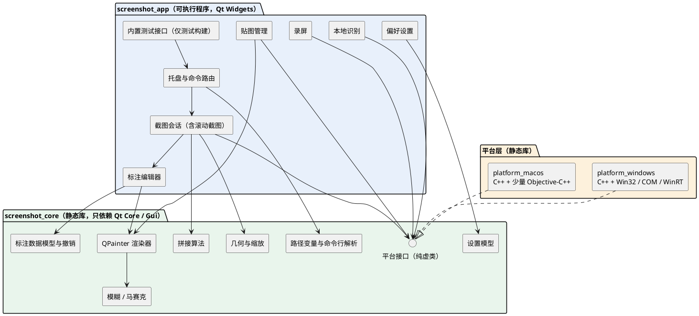
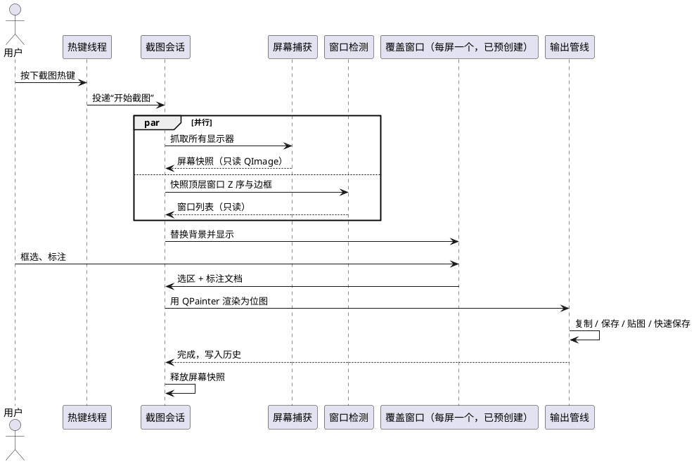
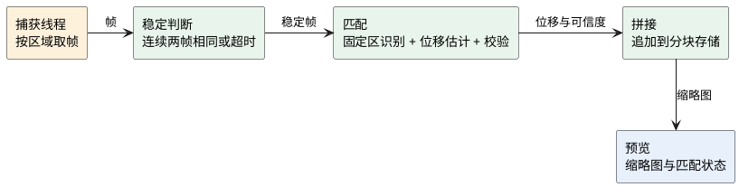
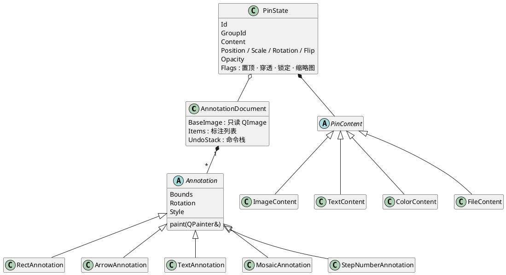
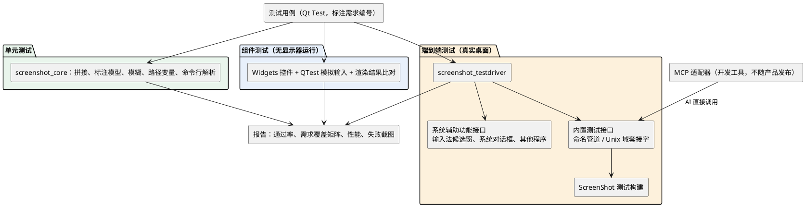

# ScreenShot 技术架构与选型

## 结论 {#decision}

Table: 技术选型（已定） {.lead}

| 项目 | 选择 | 说明 |
|---|---|---|
| 框架 | Qt 6.12 系列，不升级次版本 :m[已定] | 为继续支持 Windows 10；用开源版能拿到的最新 6.12.x 补丁；只用 LGPLv3 模块，动态链接 |
| 界面技术 | Qt Widgets :m[已定] | 不用 Qt Quick / QML；界面代码怎么组织见  |
| 绘制 | 全部 CPU：QPainter 光栅绘制 :m[已定] | 屏幕显示和导出图片用同一套绘制代码；系统截屏接口内部是否用 GPU 不在此列 |
| 语言 | C++20 :m[已定] | 与 UE 5.8 的默认标准一致；MSVC 和 Apple Clang 都已稳定支持 |
| macOS 系统接口 | 只在 macOS 平台层用少量 Objective-C++（.mm） :m[已定] | 对外只暴露纯 C++ 接口 |
| macOS 交付方式 | 只编写，不构建、不测试 :m[已定] | 目前没有 Mac 设备；macOS 代码标为未验证，有设备后再补做 |
| 编译器 | Windows：Visual Studio 2026（MSVC 14.5x）；macOS：Xcode 26（暂不使用） | Qt 6.12 官方 Windows 二进制用 MSVC 2022 构建，与 MSVC 2026 二进制兼容；macOS 构建需要 Xcode 16 或更高 |
| 构建 | CMake + Ninja | 全部命令行，适合 AI 操作 |
| IDE | Rider :m[已定] | Rider 对 CMake 的 C++ 工程还是测试版支持，遇到问题再换 CLion 或 Qt Creator |
| macOS 编译检查 | 不做 :m[已定] | 不使用云构建机；macOS 代码首次构建时错误会集中出现，届时集中修复 |

> [!warn] 锁定 Qt 6.12 的原因与代价
> Qt 官方文档写明 6.12 是最后一个支持 Windows 10 的版本。为了继续支持 Windows 10（包括你的 Windows 10 LTSC 2021 开发机），锁定 6.12 系列，不跟随之后的次版本。代价是开源版只能拿到 6.12 最初的几个补丁版本，此后 Qt 的修复（包括安全修复）不再有开源版本。等不再需要支持 Windows 10 时，再升级到当时最新的 Qt。

两个衍生影响已同步到需求文档：macOS 最低版本从 14 调整为 Qt 6.12 要求的 14.4；“GPU 加速开关”一项删除。

## 架构驱动因素 {#drivers}

Table: 架构驱动因素 {.lead}

| 需求 | 对架构的要求 |
|---|---|
| `NFR-11` Windows + macOS | 核心逻辑与界面跨平台共用；系统相关能力收敛到平台层，两个平台各实现一份 |
| `NFR-01` 热键到可框选 ≤ 150 ms | 覆盖窗口常驻并预先创建，触发时只换背景图 |
| `CAP-02` `NFR-07` 多屏、混合缩放 | 全程使用物理像素坐标；每台显示器一个覆盖窗口，不让一个窗口横跨多屏 |
| `PIN-*` `NFR-04` 大量透明置顶贴图 | CPU 绘制下，拖动不重绘、缩放走缓存，只重画可见部分 |
| `NFR-05` CPU 上 4K 马赛克 / 模糊 ≤ 100 ms | 模糊用与半径无关的线性时间算法，按块多线程处理 |
| `NFR-08` 标注显示与导出一致 | 屏幕显示和导出位图用同一个 QPainter 绘制函数、同一份标注数据 |
| `NFR-09` 界面不卡 | UI 元素检测、剪贴板大数据读取、编码、识别全部放到工作线程，并设超时 |
| `CAP-72` 自身界面不入镜 | 滚动截图的边框、工具栏、预览窗口不参与屏幕捕获 |
| `CAP-74` 超长图 | 超长图分块存储和处理，避免单张图像和绘制坐标的上限 |
| `NFR-10` 零网络 | 不链接 Qt Network 及任何网络库；依赖检查和运行时监控双重保证 |
| `TST-*` 100% 脚本化测试 | 平台能力全部经接口访问，测试时可替换；程序内置测试接口，可注入画面、驱动操作、读取状态 |

## 两款参考产品的技术栈 {#refs}

Table: 参考产品技术栈对比 {.lead}

| 维度 | Snipaste 2.11.3 | PixPin 3.5 | 本项目 |
|---|---|---|---|
| 语言 / 界面框架 | C++ / Qt 6 Widgets :m[事实] | C++ / Qt :m[推断] | C++20 / Qt 6.12 Widgets |
| 证据 | 安装目录里有 `Qt6Core` `Qt6Gui` `Qt6Widgets` `Qt6OpenGL` `Qt6Svg` `Qt6Network` `Qt6Concurrent` `Qt6Core5Compat` 等 DLL，没有 `Qt6Qml` `Qt6Quick`，可确定不用 QML | 社区评测和论坛帖称其用 Qt 开发；有用户反馈安装后缺少 Qt5 相关 DLL；官方未公开 | — |
| 平台 | Windows、macOS、Linux；2.11 起支持 Windows ARM64 :m[事实] | Windows 10+、macOS 10.15+ :m[事实] | Windows 10 1809+（受 Qt 限制，需求要求 2004+）、macOS 14.4+ |
| 绘制 | CPU 为主，OpenGL 加速马赛克、模糊、阴影；Intel / AMD 显卡默认关闭 GPU 加速 :m[事实] | 未公开 | 全部 CPU |
| 随附组件 | OpenSSL 3、QuaZip（压缩）、hoedown（Markdown 解析）、D3DCompiler、Qt 图像插件（含 WebP） :m[事实] | 未公开 | 见 ；不含任何网络库 |
| UI 元素检测 | 有“容易崩溃的进程”名单，对这些进程改用保守算法 :m[事实] | 依赖系统 UI 自动化接口 :m[事实] | 工作线程 + 短超时 + 黑名单 |
| OCR | 2.11 起 PRO 支持，含在线接口 :m[事实] | 本地离线模型，分轻量和标准两档 :m[事实] | 只做本地：系统自带 OCR 为默认，离线组件包提供增强模型 |
| 脚本 / 自动化 | 命令行 :m[事实] | 命令行 + JavaScript 语法的脚本引擎 :m[事实] | 命令行 + 嵌入式 JavaScript 引擎 + 内置测试接口 |
| 发行体积 | 约 47 MB（本机统计，不含历史与崩溃目录） :m[事实] | 未统计 | ≤ 50 MB（不含模型） |
| 内存 | 本机运行中约 130 MB 私有内存（是否开着贴图未知） :m[事实] | 未统计 | 不高于同条件下的 Snipaste |

从参考产品学到的几点：

1. Snipaste 用 Qt Widgets 覆盖三个桌面平台，与本项目的选择一致，可行性有现成证明。
2. Snipaste 只在马赛克、模糊、阴影上用 GPU 加速，并且对部分显卡默认关闭：本项目全部用 CPU，这三项要靠算法优化达标（见 ）。
3. Snipaste 专门维护了“检测容易崩溃的进程”名单：UI 元素检测必须隔离，带超时和黑名单。
4. PixPin 贴图后自动 OCR 会导致拖动卡顿：识别类任务一律放后台，低优先级，可取消。
5. PixPin 长截图只支持手动滚动，并列出了动态内容、固定栏、滚动过快等失败场景：本项目的拼接算法逐一处理，并增加自动滚动（见 ）。

> [!note] 证据边界
> Snipaste 的信息来自它的公开文档和本机安装目录的文件名，没有分析二进制内容。PixPin 本机未安装，技术栈只能依据社区说法，标为推断。

## 选型过程记录 {#history}

### 跨框架比较

Table: 被比较过的方案 {.lead}

| 方案 | 结论 | 主要理由 |
|---|---|---|
| C++ / Qt 6 | :ok[采用] | 两款参考产品都用它覆盖 Windows + macOS；macOS 系统接口可直接混编 |
| C# / .NET 10 / Avalonia 12 | :muted[未采用] | 开发效率高，但贴图、覆盖窗口、macOS 都需要原型验证；你选择了 Qt |
| C# / WPF、C# / WinUI 3 | :danger[排除] | 只支持 Windows；透明窗口有结构性短板 |
| Electron、Tauri、Flutter | :danger[排除] | 每个贴图窗口要一个网页视图或渲染引擎实例，内存开销过大 |
| Qt + Dear ImGui 画界面 | :danger[排除] | 空闲时持续重绘、控件不被系统辅助功能接口识别、输入法和透明窗口支持弱、需要自写 Qt 集成；ImGui 只可用于调试版的内部面板 |

### Qt 内部方案

Table: Qt 内部的三个选择维度 {.lead}

| 维度 | 候选 | 选择与理由 |
|---|---|---|
| 界面技术 | Widgets / Qt Quick（QML）/ 混合 | **Widgets**：托盘、菜单、设置窗口是原生控件；QPainter 让显示与导出天然一致；内存最轻；无障碍成熟。Qt Quick 每个窗口一套 GPU 渲染循环，导出与显示不是同一个渲染器，完整的 QML 编译器只在商业版里 |
| 绘制路径 | 全部 CPU / CPU + GPU 加速 / 全部 GPU | **全部 CPU**：最简单，不受显卡驱动影响，显示与导出一致；性能靠  的算法设计达标 |
| 语言 | C++ / Python（PySide6）/ Rust（CXX-Qt） | **C++**：性能、完整的 Qt 接口、参考产品同款；PySide6 内存和体积不达标；CXX-Qt 主要面向 QML |

## AI 接入与全流程 AI 操控 {#ai}

Table: 开发各环节的 AI 操控方式 {.lead}

| 环节 | 方式 | 状态 |
|---|---|---|
| 写代码、重构 | AI 直接编辑源码；Rider 2026.1 起以测试版形式支持 CMake 的 C++ 工程，可继续用 Rider MCP；Qt Creator 19 起内置 MCP 服务器 | :ok[可以] |
| 构建、单元测试 | `cmake --build`、`ctest`，全部命令行 | :ok[可以] |
| 运行与调试 | Qt Creator MCP（构建、运行、调试）或命令行调试器 | :ok[可以] |
| 检查运行中的界面 | Widgets 控件能被系统辅助功能接口（Windows UI Automation、macOS Accessibility）识别；内部状态经内置测试接口读取 | :ok[可以] |
| 系统级场景 | 热键、多屏、其他程序窗口、权限：内置测试接口 + MCP 适配器（见 ） | :ok[可以] |
| macOS | 只编写代码，不构建、不测试；有 Mac 设备后再补做构建、测试、签名和公证 | :muted[暂不] |
| 必须由人完成 | 主观的视觉判断；将来做 macOS 测试时，还有权限授予和每月确认、签名证书配置 | :muted[人工] |

## 关键技术点 {#tech}

### 界面代码组织 {#ui}

Qt Widgets 项目通常混用几种做法，并不要求界面全部用 C++ 写：

Table: Qt Widgets 项目的常见做法 {.lead}

| 做法 | 适合 | 优点 | 缺点 |
|---|---|---|---|
| Designer 的 .ui 文件（构建时由 uic 生成 C++） | 布局固定的对话框、表单 | 可视化拖拽布局，布局和逻辑分开 | XML 差异不好审阅；不适合动态生成的界面 |
| C++ 代码搭建 | 动态生成的界面、自绘控件 | 灵活，便于审阅和批量生成 | 复杂表单代码较长 |
| Qt 样式表（类似 CSS） | 换肤、局部定制外观 | 写法简单 | 被样式表接管的控件会失去原生外观，macOS 上尤其明显；大量使用影响性能 |
| 调色板 + 代理样式 | 浅色 / 深色、主题色 | 保持原生外观 | 写法比样式表繁琐 |
| 资源文件 .qrc、翻译文件 .ts | 图标、界面文字 | Qt 标准做法 | — |

本项目的分工：

Table: 本项目的界面代码分工 {.lead}

| 部分 | 做法 | 理由 |
|---|---|---|
| 覆盖窗口、贴图、标注工具栏、放大镜 | C++ 自绘 | 全部是自绘内容，没有可拖拽的标准控件 |
| 设置窗口（一百多个选项） | 由 C++ 中声明的设置表自动生成各页 | 设置项、默认值、说明文字（`CFG-04`）只写一处；自动测试可以遍历设置表逐项覆盖 |
| 其他对话框：自定义截图、贴图组管理、OCR 结果、公式识别、录屏回放、关于 | Designer 的 .ui 文件 | 布局固定，可视化编辑更快 |
| 主题 | 调色板 + 代理样式；样式表只用于少量自定义控件 | 保持系统原生外观，对应 `CFG-05` |
| 图标 | SVG，放在 .qrc 资源里 | 任意缩放比例下都清晰 |
| 界面文字 | tr() + Qt Linguist | `GEN-13` |

### Windows

Table: Windows 平台层 {.lead}

| 领域 | 选择 | 备注 |
|---|---|---|
| 屏幕捕获 | DXGI 桌面复制为主，GDI 截屏兜底 | 桌面复制可取 16 位浮点画面做 HDR；每台显示器要用其所在显卡创建的设备；每会话最多 4 个进程同时使用；远程桌面、虚拟机下失败时走 GDI |
| 自身不入镜 | SetWindowDisplayAffinity 设为“不参与捕获” | Windows 10 2004 起可用，`CAP-72` |
| 窗口检测 | 顶层窗口 Z 序 + DWM 真实边框，过滤隐藏和被遮蔽的窗口 | `CAP-11` |
| 元素检测 | UI Automation（C++ 直接用 COM），在不拥有窗口的 MTA 线程调用；连接和事务超时从默认的 2 s / 20 s 调到几百毫秒 | `CAP-12` `CAP-13` |
| 全局热键 | RegisterHotKey，经 Qt 的原生事件过滤器接收 | `ACT-01` |
| 全局鼠标 / 键盘监听 | 低级钩子，专用线程，回调只投递 | `ACT-11` `ACT-12` |
| 输入模拟 | SendInput | 自动滚动 `CAP-62` |
| 透明贴图窗口 | 无边框、置顶、透明背景的工具窗口，Qt 在 Windows 上以分层窗口实现 | 穿透用 Qt 的“不接收输入”窗口标志 |
| 虚拟桌面 | 公开接口只能查询和移动；“所有桌面”需未公开接口，做成可失效的可选功能 | `PIN-56` |
| OCR | Windows.Media.Ocr（经 C++/WinRT 调用；未打包程序能否使用说法冲突，M0 实测） | 增强模型见  |
| 录屏 | Media Foundation 编码 MP4，WASAPI 采集声音 | 系统自带，无需 FFmpeg |
| 开机自启 | 用户启动项 | `GEN-04` |
| 单实例与命令行 | 命名互斥体 + 命名管道 | 不用 Qt Network 的本机套接字 |
| 崩溃转储 | MiniDumpWriteDump | `GEN-09` |
| 打包 | windeployqt + 绿色 zip + 安装包 | `NFR-12` |

### macOS

> [!note] 只编写，不验证
> 目前没有 Mac 设备，本节的代码只编写、不构建、不测试。为了降低将来首次构建时的返工量：macOS 专有代码全部收在 `platform_macos` 里，并保持尽量薄；其余代码与 Windows 共用，在 Windows 上测试。

Table: macOS 平台层（系统接口在 .mm 文件中调用） {.lead}

| 领域 | 选择 | 备注 |
|---|---|---|
| 屏幕捕获 | ScreenCaptureKit：单帧用截图管理器，连续帧用视频流 | 需屏幕录制权限 |
| 自身不入镜 | 捕获时用内容过滤器排除本程序的窗口 | `CAP-72` |
| 权限 | 检测和申请屏幕录制、辅助功能权限（系统的 C 接口） | `GEN-14` |
| 窗口检测 | 系统窗口列表（C 接口；读取标题需屏幕录制权限） | `CAP-11` |
| 元素检测 | Accessibility 接口（C 接口），工作线程 + 超时 | 需辅助功能权限 |
| 全局热键 | 系统热键接口（C 接口），无需额外权限 | `ACT-01` |
| 全局鼠标 / 键盘监听 | 事件监听（C 接口） | 需辅助功能权限 |
| 输入模拟 | 系统事件投递（C 接口） | 需辅助功能权限 |
| 贴图窗口 | 由 Qt 创建，再经 .mm 设置浮动层级、加入所有空间；穿透用 Qt 的“不接收输入”窗口标志 | `PIN-56` 在 macOS 上用公开接口即可实现 |
| OCR | Vision 文字识别，系统自带、离线 | `REC-01` |
| 录屏 | ScreenCaptureKit + AVFoundation，系统声音由 ScreenCaptureKit 采集 | `VID-*` |
| 开机自启 | 登录项 | `GEN-04` |
| 单实例与命令行 | 文件锁 + Unix 域套接字（POSIX 接口） | 不用 Qt Network |
| 崩溃报告 | 系统崩溃报告 | `GEN-09` |
| 打包 | macdeployqt + 签名 + 公证 + 磁盘映像 | `NFR-12` |

### 两平台共用 {#shared}

Table: 两平台共用（纯 C++） {.lead}

| 领域 | 选择 | 备注 |
|---|---|---|
| 界面 | Qt Widgets，组织方式见  | 设置窗口、菜单、对话框用原生风格 |
| 覆盖窗口 | 每台显示器一个无边框置顶窗口，启动时创建并隐藏 | 背景直接用捕获到的图像 |
| 绘制 | QPainter 光栅绘制 | 同一个绘制函数既画到窗口，也画到导出用的 QImage |
| 剪贴板 | QClipboard：图像、PNG、文件列表、文本、HTML | 平台缺的格式由平台层补充 |
| 图像读写 | Qt 图像插件：PNG、JPEG、BMP、WebP；PDF 用 Qt 自带的 PDF 写入 | AVIF 为 P2，另找插件 |
| HTML 文本贴图 | QTextDocument | 不加载任何远程资源 |
| 二维码 / 条码 | ZXing-C++ | — |
| 表格 / 公式识别、智能擦除、增强 OCR | ONNX Runtime（C++ 接口）+ 开源模型，放在离线组件包 | M6 前选定模型并核对模型权重的许可证 |
| LaTeX 公式渲染 | 选一个 C++ 渲染库 | M6 前选定 |
| 脚本 | QuickJS-ng（C 语言的轻量 JavaScript 引擎） | Qt 自带的 JS 引擎在 Qt Qml 模块里，该模块可能依赖 Qt Network（待验证），为了零网络检查不用 |
| 配置 | JSON，用 Qt Core 的 JSON 类读写 | 程序目录可写时自动进入便携模式 |
| 界面文字翻译 | Qt Linguist（代码中用 tr()） | `GEN-13` |
| 并行 | 线程池按块并行（模糊、编码、拼接哈希） | — |

### CPU 绘制的性能设计 {#cpu}

Table: CPU 绘制下的性能手段 {.lead}

| 场景 | 做法 | 对应指标 |
|---|---|---|
| 高斯模糊 | 用三次盒式模糊近似高斯，每像素耗时与模糊半径无关；按块分给线程池；半径很大时先缩小、模糊、再放大 | `NFR-05` |
| 马赛克 | 按块求平均色，计算量很小 | `NFR-05` |
| 贴图阴影 | 阴影按窗口尺寸预先算好并缓存，只在尺寸变化时重算 | `NFR-04` |
| 拖动贴图 | 只移动窗口，不重绘内容 | `NFR-04` |
| 缩放贴图 | 交互过程中用快速缩放，停下后再做一次平滑缩放；大图预先生成多级缩小图，只画可见区域 | `NFR-04` |
| 覆盖窗口 | 背景直接用捕获结果，不做格式转换；只重画选区和工具栏变化的区域 | `NFR-01` |
| 标注 | 已完成的标注缓存成一层位图，只重画正在编辑的那个 | `NFR-05` |
| 超长图 | 按 4096 行分块存储，显示时只取可见的块 | `CAP-74` |

## 总体架构 {#arch}

依赖规则：

- `screenshot_core` 只依赖 Qt Core 和 Qt Gui（用到 QImage、QPainter），不依赖 Widgets，也不调用任何系统接口；平台接口在这里以纯虚类定义。
- 两个平台层各自实现平台接口；Objective-C++ 只出现在 `platform_macos` 的 .mm 文件里。
- 应用层只通过平台接口使用系统能力；测试构建可以把平台接口换成测试替身，例如用合成画面代替真实屏幕捕获。
- CMake 目标：`screenshot_app`、`screenshot_core`、`platform_windows`、`platform_macos`、`screenshot_tests`、`screenshot_testdriver`（端到端测试驱动与 MCP 适配器）。

## 关键流程 {#flows}

### 截图

内存单向流动：屏幕快照创建后只读 → 按选区裁出底图 → 标注文档引用底图 → 渲染出结果位图 → 交给各个输出目标。下游不回写上游，会话结束时整份快照一次释放。

### 滚动截图拼接 {#stitch}

算法要点（全部在 `screenshot_core` 中实现，与平台无关，可单元测试）：

1. **固定区识别**：比较相邻两帧同一行位置的像素，从顶部和底部向内统计完全相同的连续行数，多帧取稳定值，得到固定头、尾高度。对应 `CAP-65`。
2. **位移估计**：对中间滚动区逐行计算 64 位哈希，只用在上一帧中只出现一次的行作为锚点，对候选位移投票。逐行哈希一帧约 8 MB 数据，耗时在 1 ms 量级。
3. **校验**：对得票最高的位移，在整个重叠区做像素比对（允许少量抗锯齿差异）。重叠比例或锚点数量低于阈值时判为不可信，不追加并提示原因。对应 `CAP-66`。
4. **低纹理兜底**：锚点太少时，改用缩小后灰度图的行投影做相关性匹配；仍不可信则拒绝。
5. **追加与存储**：只追加位移量对应的新增行；长图按 4096 行分块存放，超长模式下分块落盘，支持 `CAP-74` 的百万像素长度。
6. **自动滚动**：在区域边缘位置模拟滚轮；连续若干次位移为 0 判定到底。对应 `CAP-62` `CAP-69`。
7. **横向拼接**：同一套算法作用在列上。对应 `CAP-63`。
8. **悬浮元素**（P2）：识别“内容在动、它不动”的像素块，从哈希中排除，并把接缝放在不含这些像素的行上。对应 `CAP-67`。

## 数据模型 {#model}

- 标注是矢量对象，每种标注只实现一个 `paint(QPainter&)`，屏幕和导出共用。二次编辑（`ANN-07`）和撤销 / 重做都基于命令栈；“清除全部”也是一条可撤销的命令。
- 贴图状态可序列化，用于重启后恢复（`PIN-54`），也供内置测试接口读取。底图另存为文件，状态文件只存引用。

## 线程模型 {#threads}

Table: 线程分工 {.lead}

| 线程 | 职责 | 约束 |
|---|---|---|
| 界面线程 | Qt 事件循环、绘制与交互 | 不做任何跨进程调用和大文件读写 |
| 热键与事件监听线程 | 全局鼠标 / 键盘事件 | 回调只投递消息 |
| 捕获线程 | 截屏、滚动截图取帧 | 结果以只读 QImage 交出 |
| 元素检测线程 | UI Automation / Accessibility 调用 | 超时几百毫秒，超时的进程临时进黑名单 |
| 线程池 | 模糊、编码、保存、OCR、识别、拼接哈希 | 可取消；识别类任务低优先级 |

## 自动化测试架构 {#tests}

- **测试框架**：Qt Test。单元测试和组件测试在无显示器模式下运行，适合持续构建。
- **需求追踪**（`TST-01`）：用例名或标注里写明覆盖的需求编号；构建时扫描需求文档里的全部编号和用例标注，生成覆盖矩阵，已交付范围内有空项即失败。
- **内置测试接口**（`TST-03`）：只编译进测试构建，发布构建里没有这段代码。提供的操作：注入合成屏幕画面和显示器布局（多屏、缩放比例、HDR）、注入剪贴板、触发动作、发送输入序列、读取贴图 / 标注 / 设置状态、获取窗口渲染结果、控制时钟。发布构建另做一轮只经系统辅助功能接口驱动的冒烟测试。
- **测试替身**：平台能力都在纯虚接口后面，测试构建可以换成合成实现，单显示器的测试机也能跑多屏、混合缩放、HDR 的逻辑用例；真实硬件用例在对应测试机上用同一套脚本运行（`TST-08`）。
- **零网络**（`TST-09`）：构建时检查最终产物没有链接 Qt Network 和任何网络库；运行全部测试时监控本进程的网络连接。
- **MCP 适配器**：把内置测试接口包装成 MCP 工具，同样用 C++ 写，AI 可以直接启动程序、注入画面、执行操作、取回截图。它是开发工具，不随产品发布。

## 第三方依赖与许可证 {#deps}

Table: 主要依赖 {.lead}

| 依赖 | 用途 | 许可证 |
|---|---|---|
| Qt 6.12：Core、Gui、Widgets、Svg、PrintSupport、Concurrent、Test | 框架、界面、打印、并行、测试 | LGPLv3 |
| Qt Image Formats | WebP 等图像格式 | LGPLv3 |
| ZXing-C++ | 二维码与条码 | Apache-2.0 |
| QuickJS-ng | JavaScript 脚本引擎 | MIT |
| ONNX Runtime（可选） | 本地模型推理 | MIT |
| macOS 系统框架 | ScreenCaptureKit、Vision、AVFoundation、Accessibility | 系统自带 |
| Windows 系统组件 | DXGI、UI Automation、Media Foundation、Windows.Media.Ocr | 系统自带 |

- 不使用 Qt Network、Qt Qml、Qt Quick。
- LGPLv3 的义务：动态链接；允许用户替换并重新链接 Qt 库；提供 Qt 源码或书面要约；附许可声明。
- 离线组件包中的模型权重另有许可证，选用时逐个核对。

## M0 技术验证 {#poc}

Table: M0 验证清单 {.lead}

| 编号 | 风险 | 验证方法 | 通过标准 | 不通过时的预案 |
|---|---|---|---|---|
| `R-01` | 工具链组合 | Qt 6.12 官方二进制 + MSVC 2026 + C++20，编译、运行一个最小程序 | 编译通过，运行正常 | 改用 Qt 支持列表中的 MSVC 2022 |
| `R-02` | 冻结画面延迟 | 两台 4K 显示器（150% / 100%），热键到可框选计时 1000 次 | P95 ≤ 150 ms | 预创建窗口、避免图像格式转换、只重画变化区域 |
| `R-03` | 混合缩放坐标精度 | 跨屏框选，与捕获原图逐像素比对 | 零偏差 | 用系统接口直接设置窗口物理位置 |
| `R-04` | 覆盖窗口上的中文输入法 | 微软拼音、搜狗 | 候选窗跟随光标，上屏正确 | 平台层直接处理输入法消息 |
| `R-05` | CPU 透明贴图性能 | 50 个 1080p 贴图带阴影，逐个拖动、缩放、开关穿透 | 拖动 ≥ 60 FPS，缩放流畅 | 缩放过程中降低质量，停下后再平滑；阴影缓存 |
| `R-06` | CPU 马赛克 / 模糊 | 4K 全图高斯模糊和马赛克计时 | ≤ 100 ms | 缩小后模糊再放大；增加并行度 |
| `R-07` | CPU 大图缩放 | 8K 贴图连续缩放 | ≥ 30 FPS 且不卡顿 | 多级缩小图 + 只画可见区域 |
| `R-08` | 常驻内存 | 无贴图运行 10 分钟后测私有内存，同条件测 Snipaste | 不高于 Snipaste，且 ≤ 150 MB | 精简加载的 Qt 插件；延迟初始化 |
| `R-09` | UI 元素检测卡死 | 对挂起的程序和大型程序（Office、浏览器）悬停检测 | 界面不卡，超时后降级为窗口检测 | 检测放到独立子进程 |
| `R-10` | HDR 色彩 | HDR 显示器上截图与 SDR 参照比对 | 不发灰、不过曝，色调映射耗时可接受 | 需要 HDR 设备；没有设备时顺延到 M5 |
| `R-11` | Windows 系统 OCR | 未打包程序经 C++/WinRT 调用，分别在你的 LTSC 2021 和 Windows 11 上测 | 能识别中英文 | 改用 ONNX Runtime + PP-OCR 模型作为 Windows 默认 OCR |
| `R-12` | 双显卡笔记本捕获 | 外接屏挂在独显、内屏挂在核显时截图 | 两块屏都能捕获 | 按显卡分别创建设备，仍失败则该屏走 GDI |
| `R-13` | macOS 贴图窗口 :muted[延后] | Qt 窗口经 .mm 设置浮动层级、穿透、所有空间；在全屏程序上方显示 | 行为正确 | 改用系统面板类窗口承载 |
| `R-14` | macOS 截图延迟 :muted[延后] | 截图管理器单帧捕获计时 | P95 ≤ 150 ms | 常驻视频流取最新帧（代价是菜单栏持续显示录屏指示） |
| `R-15` | macOS 权限与无人值守测试 :muted[延后] | 测试机预授权后连续运行端到端用例 | 除系统每月确认外无需人工 | 端到端用例改用测试替身，真实捕获只做冒烟测试 |
| `R-16` | 测试替身覆盖多屏用例 | 单显示器机器上用合成显示器跑完全部多屏用例 | 结果与真实多屏一致 | 补充虚拟显示器 |
| `R-17` | Qt Qml 是否依赖 Qt Network | 检查官方二进制的依赖 | 有依赖则维持 QuickJS-ng 方案 | — |

M0 只在 Windows 上进行，标为“延后”的三项等有 Mac 设备后再验证。不达标时按预案处理；预案仍不达标时，调整对应的需求指标并在需求文档中记录。

## 参考资料

- [Snipaste 官方文档](https://docs.snipaste.com/){.pill}、[PixPin 使用文档](https://pixpin.cn/docs/start/what-is-pixpin){.pill}
- [V2EX：PixPin 发布帖](https://www.v2ex.com/t/989393){.pill}、[小众软件论坛：PixPin 推荐](https://meta.appinn.net/t/topic/49017){.pill}
- Qt：[支持的平台](https://doc.qt.io/qt-6/supported-platforms.html){.pill}、[Qt 6.12 发布](https://www.qt.io/blog/qt-6.12-released){.pill}、[Qt 发布与 LTS 政策](https://doc.qt.io/qt-6/qt-releases.html){.pill}、[Qt LGPL 义务](https://www.qt.io/licensing/open-source-lgpl-obligations){.pill}、[Qt for Windows 图形](https://doc.qt.io/qt-6/windows-graphics.html){.pill}、[QML 脚本编译器](https://doc.qt.io/qt-6/qtqml-qml-script-compiler.html){.pill}
- C++ 标准：[Epic C++ 编码规范（UE 默认 C++20）](https://dev.epicgames.com/documentation/unreal-engine/epic-cplusplus-coding-standard-for-unreal-engine?lang=en-US){.pill}
- AI 工具：[Qt Creator 19 发布（内置 MCP）](https://www.qt.io/blog/qt-creator-19-released){.pill}、[Qt Creator 20 发布](https://www.qt.io/blog/qt-creator-20-released){.pill}、[Rider 2026.1 新功能](https://www.jetbrains.com.cn/rider/whatsnew/2026-1){.pill}
- Dear ImGui：[空闲省电](https://github.com/ocornut/imgui/wiki/Implementing-Power-Save%2C-aka-Idling-outside-of-ImGui){.pill}、[Test Engine 许可](https://awesome.ecosyste.ms/projects/github.com%2Focornut%2Fimgui_test_engine){.pill}
- Windows：[DuplicateOutput1](https://learn.microsoft.com/en-us/windows/win32/api/dxgi1_5/nf-dxgi1_5-idxgioutput5-duplicateoutput1){.pill}、[SetWindowDisplayAffinity](https://learn.microsoft.com/en-us/windows/win32/api/winuser/nf-winuser-setwindowdisplayaffinity){.pill}、[UIA 线程要求](https://learn.microsoft.com/en-us/windows/win32/winauto/uiauto-threading){.pill}、[UIA 事务超时](https://learn.microsoft.com/en-us/windows/win32/api/uiautomationclient/nf-uiautomationclient-iuiautomation2-put_transactiontimeout){.pill}、[桌面应用可用的 WinRT 接口](https://learn.microsoft.com/en-us/windows/apps/desktop/modernize/winrt-api-desktop-app-support){.pill}、[IVirtualDesktopManager](https://learn.microsoft.com/en-us/windows/win32/api/shobjidl_core/nn-shobjidl_core-ivirtualdesktopmanager){.pill}
- macOS：[每月确认屏幕录制权限（9to5Mac）](https://9to5mac.com/2024/08/14/macos-sequoia-screen-recording-prompt-monthly/){.pill}、[“请求绕过系统窗口选择器”提示（Apple 开发者论坛）](https://developer.apple.com/forums/thread/765103){.pill}
- 图像：[WebP 常见问题](https://developers.google.com/speed/webp/faq){.pill}
